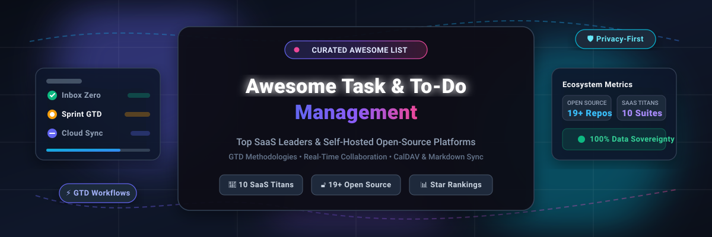

<p align="center">
  
</p>

<p align="center">
  <a href="https://github.com/ishandutta2007/Awesome-Awesome-Awesome"></a>
  <a href="https://discord.gg/jc4xtF58Ve"></a>
  <a href="https://github.com/ishandutta2007/Awesome-Task-To-Do-Management/stargazers"></a>
  <a href="https://github.com/ishandutta2007/Awesome-Task-To-Do-Management/network/members"></a>
  <a href="https://github.com/ishandutta2007/Awesome-Task-To-Do-Management/blob/main/LICENSE"></a>
  <a href="https://github.com/ishandutta2007/Awesome-Task-To-Do-Management/issues"></a>
  <a href="https://github.com/ishandutta2007"></a>
</p>

---

# 📋 Awesome Task & To-Do Management

Welcome to the definitive, community-curated index of the **Top Task & To-Do Management Tools Ecosystem**. This directory benchmarks enterprise **SaaS powerhouses** alongside privacy-first, self-hostable **open-source GitHub projects**. Whether you are optimizing a personal **Getting Things Done (GTD)** system, seeking a local-first plain-text Markdown tracker, or deploying an organization-wide collaborative Kanban board, this guide provides granular feature breakdowns, verified pricing models, and repo rankings.

> **SEO & Keywords**: Task Management Software, To-Do List Apps, Self-Hosted Task Manager, Open Source Kanban, GTD Productivity Tools, Time Tracking Integration, CalDAV Sync, Local-First Productivity, Markdown Task Boards.

---

## 📑 Table of Contents

- [📊 Sector Overview & Market Dynamics](#-sector-overview--market-dynamics)
- [🏢 SaaS & Hosted Platforms](#-saas--hosted-platforms)
- [🔓 Open-Source GitHub Projects](#-open-source-github-projects)
  - [⚡ Open-Source Quick Comparison](#-open-source-quick-comparison)
  - [🔍 Detailed Project Overviews (Sorted by Stars)](#-detailed-project-overviews-sorted-by-stars)
- [🛠️ Architectural Recommendations](#️-architectural-recommendations)
- [🤝 How to Contribute](#-how-to-contribute)
- [📈 Star History](#-star-history)
- [💖 Support & Community](#-support--community)
- [📜 Disclaimer & Licensing](#-disclaimer--licensing)

---

## 📊 Sector Overview & Market Dynamics

The global task management software market is estimated at **$4.8 billion in 2025/2026** and is projected to expand to **$9.6 billion by 2030**, reflecting a compound annual growth rate (**CAGR of ~13.5%**). Growth is propelled by distributed workforce coordination, digital transformation across knowledge sectors, and the integration of autonomous AI task decomposition.

The sector is **moderately fragmented**: mega-cap enterprise suites (such as Microsoft 365, Asana, and Google Workspace) command major portions of total enterprise spend; however, the space does *not* exhibit winner-take-all dynamics. Instead, extreme user workflow diversity sustains vibrant, profitable prosumer platforms (Todoist, Things 3, TickTick), alongside an accelerating **self-hosted and local-first open-source surge** (Plane, Focalboard, Super Productivity, Vikunja) driven by corporate data sovereignty, compliance mandates, and developer preference for plain-text storage.

---

## 🏢 SaaS & Hosted Platforms

The following table benchmarks category-defining proprietary and hosted SaaS task management platforms, **ranked in descending order of company scale** (market capitalization, enterprise valuation, or annual recurring revenue).

| 🏷️ Platform | 🏛️ Company Scale (Valuation / Revenue) | 💳 Starting Tier Price | 🎁 Free Tier Limit | 🎯 Key Workflows & Platforms |
| :--- | :--- | :--- | :--- | :--- |
| **[Microsoft To Do](https://to-do.office.com/)** | **$3.1+ Trillion Market Cap**<br>*(~$245B+ Annual Revenue)* | **$6.00 / user / month**<br>*(Microsoft 365 Business Basic; consumer app 100% free)* | **Free forever** with any personal Microsoft Account. Includes unlimited tasks, lists, smart "My Day" suggestions, 25MB attachment limit per task, and full Outlook synchronization. | Outlook email flagging, Microsoft 365 ecosystem integration, Windows/macOS/iOS/Android/Web. |
| **[Asana](https://asana.com/)** | **$2.8 Billion Market Cap**<br>*(~$650M ARR; NYSE: ASAN)* | **$10.99 / user / month**<br>*(Starter plan, billed annually; $13.49 billed monthly)* | **Free forever for up to 10 teammates**. Includes unlimited tasks, projects, messages, activity logs, 100MB file attachments per file, and basic List/Board/Calendar views. | Enterprise project workflows, Gantt timelines, workflow automations, Web/Desktop/Mobile. |
| **[Todoist](https://todoist.com/)** | **~$100 Million Valuation**<br>*(~$30M ARR; 40M+ users)* | **$4.00 / user / month**<br>*(Pro plan, billed annually at $48/yr; $5.00 billed monthly)* | **Free forever for up to 5 active personal projects**, 5 collaborators per project, 3 custom filter views, 1-week activity history, and 5MB per file attachment. | Gold-standard Natural Language processing, GTD Karma, two-way calendar sync, cross-platform. |
| **[Any.do](https://any.do/)** | **~$45 Million Valuation**<br>*(~$12M ARR; 30M+ users)* | **$3.00 / user / month**<br>*(Premium, billed annually at $35.99/yr; $5.99 billed monthly)* | **Free forever for single personal user**. Includes standard to-do lists, daily "Moment" planner, basic reminders, and 1.5MB file upload limit (excludes advanced recurring reminders and tags). | Daily planning routines, WhatsApp integration, smart calendar synchronization, iOS/Android/Web. |
| **[TickTick](https://ticktick.com/)** | **~$12 Million ARR**<br>*(Private; 5M+ users)* | **$3.00 / month**<br>*(Billed annually at $35.99/year; $3.99 billed monthly)* | **Free forever with up to 9 lists**, 99 tasks per list, 19 checklist items per task, 1 attachment upload per day, and standard Pomodoro timer (excludes full calendar views). | Integrated Pomodoro timer, habit tracking counters, Eisenhower matrix view, Markdown notes. |
| **[Things 3](https://culturedcode.com/things/)** | **~$8 Million ARR**<br>*(Private / Bootstrapped; Apple Design Award)* | **$9.99 one-time** (iPhone/Watch)<br>**$19.99 one-time** (iPad)<br>**$49.99 one-time** (macOS) | **14-day free trial on macOS** with 100% full feature access and unlimited Things Cloud sync. *Zero permanent free version available on iOS*. | Benchmark Apple ergonomics, strict Getting Things Done (GTD) methodology, ultra-fast capture. |
| **[OmniFocus 4](https://www.omnigroup.com/omnifocus/)** | **~$6 Million ARR**<br>*(Private; Pioneer Apple GTD Suite)* | **$9.99 / month**<br>*(Or $99.99/yr universal sub; or $74.99 one-time Standard / $149.99 Pro)* | **14-day free trial** with full Pro feature access across macOS, iOS, iPadOS, and Web. Reverts to read-only viewer upon expiration (*zero permanent free tier*). | Power-user GTD customization, custom perspectives, forecast views, AppleScript and JXA automation. |
| **[Habitica](https://habitica.com/)** | **~$3 Million ARR**<br>*(Private; 4M+ registered players)* | **$4.99 / month**<br>*(Or $47.99 billed annually; group plans at $3/member/mo + $9/mo)* | **Free forever with 100% unlimited habits, dailies, to-dos**, party quests, accountability chats, and avatar leveling (subscription unlocks cosmetic gems and mystery items). | RPG gamification, party boss battles, accountability covenants, habit streak reinforcement. |
| **[Remember The Milk](https://www.rememberthemilk.com/)** | **~$2.5 Million ARR**<br>*(Private; founded 2005)* | **$4.17 / month**<br>*(Billed annually at $49.99/year for Pro)* | **Free forever with unlimited tasks and lists**, 1 manual cloud sync per 24 hours across mobile devices. Excludes subtasks, push notifications, tag badges, and offline mode. | Boolean smart lists, keyboard-shortcut mastery, natural date syntax, veteran reliability. |
| **[Toodledo](https://www.toodledo.com/)** | **~$1.0 Million ARR**<br>*(Private)* | **$2.99 / month**<br>*(Standard plan, billed annually at $35.88/yr; $4.99/mo for Plus)* | **Free forever with up to 30 tasks per list**, basic notes, outlines, and 1 collaborator per task. Excludes subtasks, customizable alarms, graphs, and full historical logs. | Multi-attribute task sorting, modular outlining, customizable priority weights, time tracking. |

---

## 🔓 Open-Source GitHub Projects

Explore the premier open-source task management, Kanban, and GTD repositories. **Ranked strictly in descending order of GitHub stargazers**.

### ⚡ Open-Source Quick Comparison

| 📦 Repository | ⭐ GitHub_Stars | 📜 License | 🛠️ Architecture / Stack | 🔄 Primary Sync / Storage |
| :--- | :--- | :--- | :--- | :--- |
| **[Plane](#1-plane)** | [](https://github.com/makeplane/plane/stargazers) | AGPL-3.0 | Next.js, Django, PostgreSQL, Redis | Self-Hosted Docker / Plane Cloud |
| **[Focalboard](#2-focalboard)** | [](https://github.com/mattermost-community/focalboard/stargazers) | MIT / AGPL | Go, React, TypeScript, SQLite/Postgres | Mattermost Integration / Standalone Docker |
| **[Super Productivity](#3-super-productivity)** | [](https://github.com/super-productivity/super-productivity/stargazers) | MIT | Angular, Electron, Web Workers | WebDAV, Dropbox, Google Drive, Local File |
| **[Wekan](#4-wekan)** | [](https://github.com/wekan/wekan/stargazers) | MIT | Node.js, Meteor, MongoDB | Self-Hosted Docker / Snap / Cloudron |
| **[OpenProject](#5-openproject)** | [](https://github.com/opf/openproject/stargazers) | GPL-3.0 | Ruby on Rails, Angular, PostgreSQL | Enterprise On-Premises / Managed Cloud |
| **[Habitica (Open Source)](#6-habitica)** | [](https://github.com/HabitRPG/habitica/stargazers) | GPL-3.0 | Vue.js, Express.js, MongoDB | Self-Hosted Docker / Habitica Servers |
| **[Planka](#7-planka)** | [](https://github.com/plankanban/planka/stargazers) | AGPL-3.0 | React, Redux, Sails.js, PostgreSQL | Lightweight Docker Compose / Helm |
| **[Leantime](#8-leantime)** | [](https://github.com/Leantime/leantime/stargazers) | GPL-2.0 | PHP, MySQL, JavaScript | Self-Hosted Docker / AWS / Managed |
| **[Taskbook](#9-taskbook)** | [](https://github.com/klaudiosinani/taskbook/stargazers) | MIT | Node.js, CLI | Zero-dependency local JSON file |
| **[Taskwarrior](#10-taskwarrior)** | [](https://github.com/GothenburgBitFactory/taskwarrior/stargazers) | MIT | C++, Rust (v3+), CLI | Taskserver / sync-server encrypted sync |
| **[Vikunja](#11-vikunja)** | [](https://github.com/go-vikunja/vikunja/stargazers) | AGPL-3.0 | Go, Vue 3, SQLite / PostgreSQL / MySQL | Native CalDAV, WebSockets, REST API |
| **[Planify](#12-planify)** | [](https://github.com/alainm23/planify/stargazers) | GPL-3.0 | Vala, GTK4, Libadwaita | Todoist REST API, Nextcloud, CalDAV |
| **[Tasks.org](#13-tasksorg)** | [](https://github.com/tasks/tasks/stargazers) | GPL-3.0 | Kotlin, Android SDK, Room DB | DAVx⁵ (CalDAV), EteSync, Google Tasks |
| **[Donetick](#14-donetick)** | [](https://github.com/donetick/donetick/stargazers) | GPL-3.0 | Go, Vue.js, SQLite | Self-Hosted Docker / Home Assistant Add-on |
| **[Mindwtr](#15-mindwtr)** | [](https://github.com/dongdongbh/Mindwtr/stargazers) | GPL-3.0 | Swift, SwiftUI, Apple SDKs | iCloud, WebDAV, Dropbox, Local Folder |
| **[Nextcloud Tasks](#16-nextcloud-tasks)** | [](https://github.com/nextcloud/tasks/stargazers) | AGPL-3.0 | PHP, Vue.js, CalDAV standard | Built-in Nextcloud CalDAV backend |
| **[Mimrai](#17-mimrai)** | [](https://github.com/mimrai-org/mimrai/stargazers) | AGPL-3.0 | TypeScript, Bun, Next.js, Supabase | Self-Hosted Supabase / Docker |
| **[Jotter](#18-jotter)** | [](https://github.com/simon123h/Jotter/stargazers) | MIT | Python, Markdown engine, CLI/GUI | Git-backed repository, local Markdown |
| **[Alkonost](#19-alkonost)** | [](https://github.com/szholobetsky/alkonost/stargazers) | MIT | Python, Markdown/Plain-Text Parser | 100% Local Checklist text file |

---

### 🔍 Detailed Project Overviews (Sorted by Stars)

#### 1. [Plane](https://github.com/makeplane/plane) [](https://github.com/makeplane/plane/stargazers)
- **Overview**: The leading open-source project and issue management suite built as an extensible alternative to Jira, Linear, and ClickUp.
- **Key Capabilities**: Cycles (sprints), modules, customized board views, list layouts, Gantt roadmaps, rich-text issue documentation, and triage flows.
- **Tech Stack & Deployment**: TypeScript, Next.js, Django, PostgreSQL, Redis. Deploys seamlessly via Docker Compose or Kubernetes Helm charts.
- **Best For**: Engineering organizations and product teams requiring scalable sprint and task tracking.

#### 2. [Focalboard](https://github.com/mattermost-community/focalboard) [](https://github.com/mattermost-community/focalboard/stargazers)
- **Overview**: An open-source, multilingual self-hosted project and work tracking dashboard serving as an alternative to Trello, Notion, and Asana.
- **Key Capabilities**: Kanban boards, table views, gallery layouts, and calendar views. Includes pre-configured templates for sprint planning and editorial calendars.
- **Tech Stack & Deployment**: Go backend, React/TypeScript frontend. Runs standalone via single-binary or Docker, or embedded natively within Mattermost.
- **Best For**: Teams seeking a lightweight, multi-view board tracker without SaaS vendor lock-in.

#### 3. [Super Productivity](https://github.com/super-productivity/super-productivity) [](https://github.com/super-productivity/super-productivity/stargazers)
- **Overview**: An advanced personal task manager that combines to-do management with native time tracking, timeboxing, and habit tracking. Replaces TickTick and Toggl in a unified app.
- **Key Capabilities**: One-level deep subtasks, time estimation vs. actual tracking, Pomodoro timer, break reminders, Jira/GitHub/GitLab two-way sync, and keyboard-driven task capture (`+project`, `#tag`, `@due`).
- **Tech Stack & Deployment**: Angular, Electron, Web Workers. Zero mandatory backend — syncs via WebDAV, Dropbox, Google Drive, or local storage.
- **Best For**: Developers, solo entrepreneurs, and remote knowledge workers wanting granular time-audit tracking.

#### 4. [Wekan](https://github.com/wekan/wekan) [](https://github.com/wekan/wekan/stargazers)
- **Overview**: The long-standing, battle-tested open-source Kanban board platform with strict privacy and zero telemetry.
- **Key Capabilities**: Swimlanes, custom fields, card colors, subtasks, checklist hierarchies, voting, rules-based triggers, and LDAP/OAuth2 authentication.
- **Tech Stack & Deployment**: Meteor.js, Node.js, MongoDB. Deployable via Snap, Docker, UCS, Sandstorm, or Cloudron.
- **Best For**: Highly regulated environments, enterprises, and schools demanding an on-premises Trello alternative.

#### 5. [OpenProject](https://github.com/opf/openproject) [](https://github.com/opf/openproject/stargazers)
- **Overview**: Enterprise-grade open-source project and portfolio management software supporting both traditional waterfall and agile workflows.
- **Key Capabilities**: Interactive Gantt charts, sprint backlog boards, time tracking, cost reporting, document hierarchies, and granular permission matrices.
- **Tech Stack & Deployment**: Ruby on Rails, Angular, PostgreSQL. Packaged as official Docker containers, DEB/RPM packages, or cloud hosting.
- **Best For**: Mid-to-large enterprises needing comprehensive compliance, audit trails, and multi-team Gantt scheduling.

#### 6. [Habitica (Open Source)](https://github.com/HabitRPG/habitica) [](https://github.com/HabitRPG/habitica/stargazers)
- **Overview**: The full open-source codebase powering the popular Habitica habit and task-tracking RPG web platform.
- **Key Capabilities**: Turn daily routines into RPG quests. Completing habits, daily commitments, and to-do lists awards XP and gold; procrastination deals damage to your character and party members.
- **Tech Stack & Deployment**: Vue.js, Node.js/Express, MongoDB. Self-hostable using Docker Compose.
- **Best For**: Gamification enthusiasts wanting complete control over their gaming-productivity infrastructure.

#### 7. [Planka](https://github.com/plankanban/planka) [](https://github.com/plankanban/planka/stargazers)
- **Overview**: An elegant, modern, and snappy open-source Kanban board designed specifically for agile product teams.
- **Key Capabilities**: Real-time board synchronization via WebSockets, customizable card labels, Markdown task descriptions, card memberships, and attachments.
- **Tech Stack & Deployment**: React, Redux, Sails.js, PostgreSQL. Ultra-lean resource footprint on Docker.
- **Best For**: Small teams seeking a modern, visually clean Kanban setup that runs on modest VPS hardware.

#### 8. [Leantime](https://github.com/Leantime/leantime) [](https://github.com/Leantime/leantime/stargazers)
- **Overview**: A goals-focused open-source project management platform tailored for non-project managers, with deliberate ergonomic design for neurodivergent individuals (ADHD, autism, dyslexia).
- **Key Capabilities**: Combines strategy roadmaps, Kanban task boards, milestone Gantt views, idea validation boards, and timesheet logging.
- **Tech Stack & Deployment**: PHP, MySQL, JavaScript. Available via Docker Compose, Unraid, and Synology packages.
- **Best For**: Solopreneurs, startups, and creative thinkers who find conventional project tools overwhelming.

#### 9. [Taskbook](https://github.com/klaudiosinani/taskbook) [](https://github.com/klaudiosinani/taskbook/stargazers)
- **Overview**: Minimalist, distraction-free command-line task and note management utility designed for terminal habitats.
- **Key Capabilities**: Manage tasks and notes across multiple boards, star priority items, check off items, timeline view, and search filter syntax directly in stdout.
- **Tech Stack & Deployment**: Node.js CLI, zero server infrastructure required. Stores records in an atomic JSON file in `~/.taskbook`.
- **Best For**: Developers and sysadmins who work continuously inside terminal sessions.

#### 10. [Taskwarrior](https://github.com/GothenburgBitFactory/taskwarrior) [](https://github.com/GothenburgBitFactory/taskwarrior/stargazers)
- **Overview**: The quintessential power-user CLI task manager with decades of development, rich filtering logic, and custom priority heuristics.
- **Key Capabilities**: Task urgency calculation algorithms, dependency chains (`depends:`), recurring schedules, custom annotations, and encrypted synchronization via Taskserver or sync-server.
- **Tech Stack & Deployment**: C++ (v2), Rust (v3+). Native packages across all Linux distributions, Homebrew, and Windows Scoop/WSL.
- **Best For**: Terminal power-users desiring programmable query capabilities and automated urgency ranking.

#### 11. [Vikunja](https://github.com/go-vikunja/vikunja) [](https://github.com/go-vikunja/vikunja/stargazers)
- **Overview**: The leading open-source, self-hosted end-to-end task management suite. Crafted by a bootstrapped core team emphasizing data autonomy and zero investor interference.
- **Key Capabilities**: Four views (List, Kanban, Gantt, and Table) switchable on the fly; subtasks, priorities, labels, reminders, task relations (blocking/blocked by), native CalDAV server, and filter query syntax. Universal importer for Todoist, Trello, TickTick, and Microsoft To-Do.
- **Tech Stack & Deployment**: High-performance Go API backend, modern Vue 3 frontend. Deploys via Docker with SQLite (single node) or PostgreSQL/MySQL. Managed Vikunja Cloud available at €4/month.
- **Best For**: Teams and individuals wanting a full-featured, self-hostable alternative to Todoist and Asana with CalDAV synchronization.

#### 12. [Planify](https://github.com/alainm23/planify) [](https://github.com/alainm23/planify/stargazers)
- **Overview**: A modern, native GTK4/Libadwaita task manager crafted for the GNOME Linux desktop with first-class cloud synchronization.
- **Key Capabilities**: Synchronizes natively with Todoist and Nextcloud via CalDAV; supports quick-capture CLI, drag-and-drop reordering, progress tracking, and non-completable note tasks (prefixed with `*`).
- **Tech Stack & Deployment**: Vala, GTK4, Libadwaita. Distributed via Flatpak on Flathub for all Linux distributions.
- **Best For**: Linux desktop users seeking native system integration alongside Todoist and Nextcloud synchronization.

#### 13. [Tasks.org](https://github.com/tasks/tasks) [](https://github.com/tasks/tasks/stargazers)
- **Overview**: The gold standard for open-source, privacy-first mobile task management on Android (forked and modernized from the Astrid codebase).
- **Key Capabilities**: Unlimited subtask nesting, location-triggered geofence reminders, Android homescreen widgets, Tasker automation hooks, and Wear OS companion app.
- **Tech Stack & Deployment**: Kotlin, Android SDK, Room DB. Syncs with Tasks.org Cloud, CalDAV (DAVx⁵, Nextcloud), Google Tasks, Microsoft To Do, or operates 100% offline.
- **Best For**: Android users demanding local storage control, zero ads, zero tracking, and deep system widget integration.

#### 14. [Donetick](https://github.com/donetick/donetick) [](https://github.com/donetick/donetick/stargazers)
- **Overview**: A modern, self-hostable chore and household task organizer built for multi-user family coordination.
- **Key Capabilities**: Gamified chore point awards redeemable for custom rewards; rotating auto-assignments based on least-completed tasks, completion-relative repeat intervals, and Home Assistant add-on integration.
- **Tech Stack & Deployment**: Go backend, Vue.js frontend, SQLite database. Packaged as a Docker container and Home Assistant add-on.
- **Best For**: Households, roommates, and families coordinating shared responsibilities without corporate tracking.

#### 15. [Mindwtr](https://github.com/dongdongbh/Mindwtr) [](https://github.com/dongdongbh/Mindwtr/stargazers)
- **Overview**: An open-source, offline-first GTD application designed for the Apple platform ecosystem (macOS, iOS, watchOS).
- **Key Capabilities**: Native GTD buckets (Inbox, Next Actions, Waiting For, Someday/Maybe, Projects, Areas, Contexts), weekly review flow, and Markdown notes. Syncs across personal iCloud, WebDAV, Dropbox, or local directory without proprietary servers.
- **Tech Stack & Deployment**: Swift, SwiftUI. Runs client-side; zero external infrastructure needed.
- **Best For**: Apple users seeking an open-source, privacy-preserving alternative to Things 3 and OmniFocus.

#### 16. [Nextcloud Tasks](https://github.com/nextcloud/tasks) [](https://github.com/nextcloud/tasks/stargazers)
- **Overview**: The official task management application for the Nextcloud self-hosted productivity ecosystem.
- **Key Capabilities**: Full CalDAV task synchronization standard (RFC 5545/4791), subtasks, priority weights, category tags, due dates, and seamless interoperability with Android (Tasks.org) and iOS (Reminders via CalDAV).
- **Tech Stack & Deployment**: PHP, Vue.js. Installed as a 1-click application inside any Nextcloud instance.
- **Best For**: Users and organizations already running Nextcloud who want centralized calendar and task synchronization.

#### 17. [Mimrai](https://github.com/mimrai-org/mimrai) [](https://github.com/mimrai-org/mimrai/stargazers)
- **Overview**: An emerging, lightweight task and issue tracking alternative to Jira, Asana, and Linear built on modern TypeScript primitives.
- **Key Capabilities**: Real-time collaborative task updates, intuitive card categorization, flexible workspaces, and minimalist user interface.
- **Tech Stack & Deployment**: Bun, Turborepo, Next.js, Supabase, Tailwind CSS, Shadcn UI.
- **Best For**: Developers seeking an approachable TypeScript full-stack codebase to customize or self-host.

#### 18. [Jotter](https://github.com/simon123h/Jotter) [](https://github.com/simon123h/Jotter/stargazers)
- **Overview**: A local-first, privacy-respecting task management tool that persists all data strictly as human-readable plain-text Markdown files.
- **Key Capabilities**: Markdown Kanban boards, Eisenhower Matrix view, Git-backed synchronization with granular per-project remotes, Git Time Machine snapshot rollbacks, and Model Context Protocol (MCP) support for AI agent integration.
- **Tech Stack & Deployment**: Python, standalone executables or `pipx run jotter-app`. Android offline companion available.
- **Best For**: Obsidian/PKM practitioners and plain-text enthusiasts who want local files combined with AI agent hooks.

#### 19. [Alkonost](https://github.com/szholobetsky/alkonost) [](https://github.com/szholobetsky/alkonost/stargazers)
- **Overview**: A zero-configuration local Kanban board engine that stores an entire project's backlog inside a single plain-text checklist file.
- **Key Capabilities**: Formatted task descriptions with tables, live formulas, and diagrams; board and backlog split views, and 8 built-in themes.
- **Tech Stack & Deployment**: Python (`pip install alkonost`), runs locally via browser UI. Zero external databases or background daemons.
- **Best For**: Researchers and coders wanting zero-friction board visualization over single text files.

---

## 🛠️ Architectural Recommendations

To build a sovereign, cross-device task management ecosystem tailored to your workflow, combine best-of-breed open-source tools:

```
┌────────────────────────────────────────────────────────┐
│             SOVEREIGN TASK ARCHITECTURE                │
├────────────────────────────────────────────────────────┤
│  🏢 Web & Org Coordination : Vikunja / Plane           │
│  📱 Mobile Capture (Android): Tasks.org via CalDAV     │
│  🍎 Mobile Capture (Apple)  : Mindwtr via WebDAV/iCloud│
│  ⏱️ Focus & Time Tracking  : Super Productivity       │
│  📝 Plain-Text & PKM        : Jotter / Markdown files  │
│  💻 Terminal CLI Habitat   : Taskwarrior / Taskbook    │
└────────────────────────────────────────────────────────┘
```

---

## 🤝 How to Contribute

Contributions from the developer and productivity communities are warmly welcomed! To suggest a tool or update existing benchmarks:

1. 🍴 **Fork the repository** on GitHub.
2. 🌿 **Create a dedicated branch**: `git checkout -b feature/add-new-tool`.
3. 📝 **Add or edit entries in `README.md`**:
   - Maintain objective, factual descriptions.
   - For SaaS products, provide exact starting prices, company scale figures, and verified free tier limits.
   - For open-source repos, include the repository URL, correct Stars_Badge linking to `/stargazers`, stack, and license.
4. 🚀 **Submit a Pull Request** with a concise explanation of your additions.

---

## 📈 Star History

[](https://star-history.dera.page/#ishandutta2007/Awesome-Task-To-Do-Management&type=date&legend=top-left)

---

## 💖 Support & Community

Thank you for exploring this curated repository! If you find this directory valuable for selecting tools or configuring a sovereign task management system:

- ⭐ **Star this repository** to improve discoverability for other developers and teams.
- 🍴 **Fork and contribute** to keep the benchmarks up to date.
- 📢 **Share with colleagues** and productivity communities.
- ☕ **Sponsor ongoing maintenance**: Help support independent research and open-source documentation via the [GitHub Sponsors Dashboard](https://github.com/sponsors/ishandutta2007).

---

## 📜 Disclaimer & Licensing

- This repository is a **community-curated benchmark** for informational purposes; listings do not constitute commercial endorsements.
- Feature tiers, free tier constraints, and pricing rates are subject to vendor changes. Please verify directly with official product documentation.
- Self-hosted open-source software shifts security, backups, and operational maintenance to the host. Always review container configurations and data persistence policies before production deployment.
- **License**: Released under the [MIT License](LICENSE). Curated with ❤️ by [Ishan Dutta](https://github.com/ishandutta2007).
